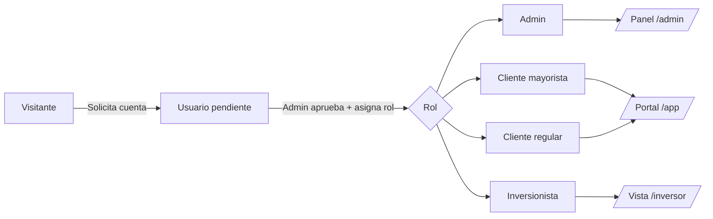
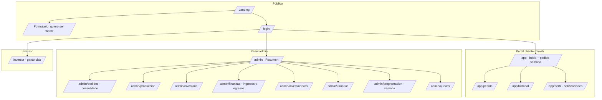
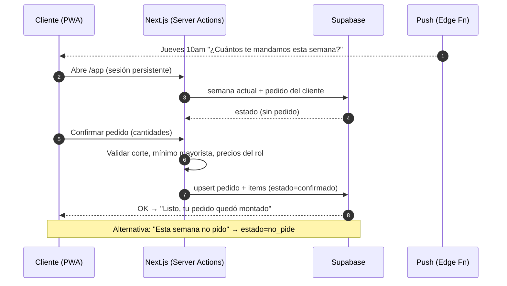
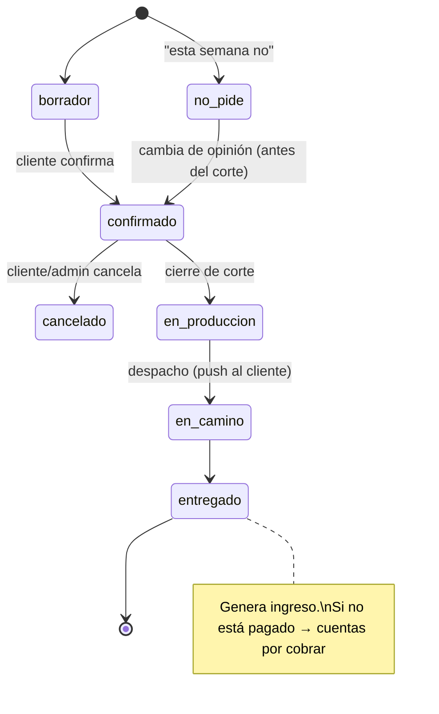
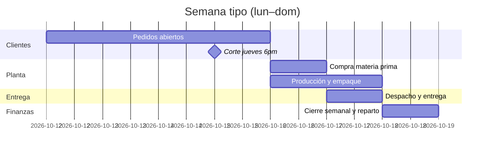
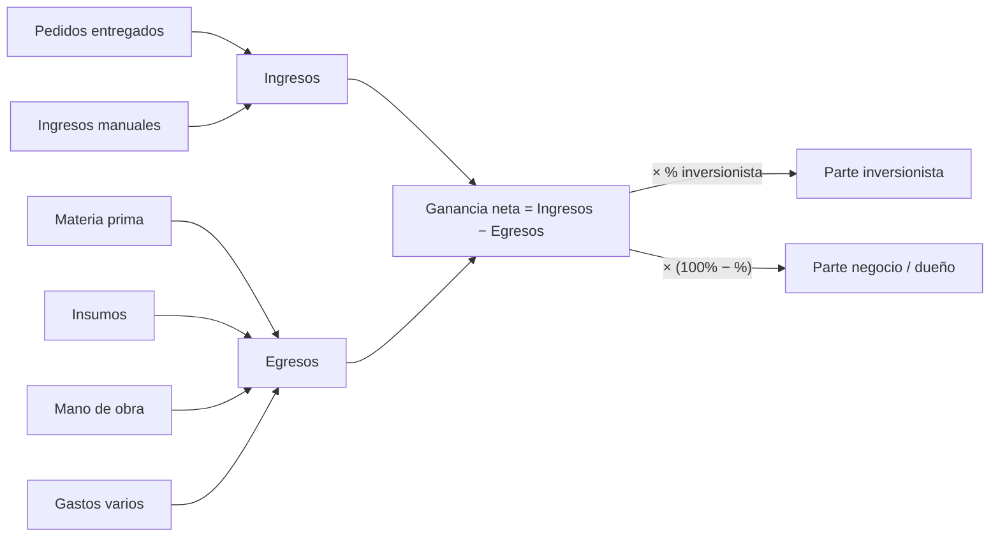
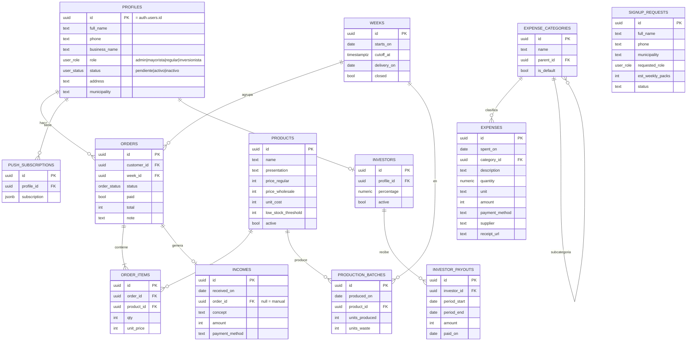
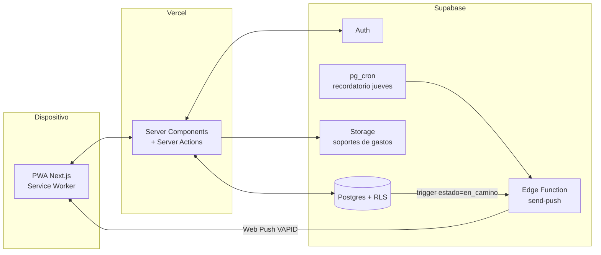

# PRD — Tostones Zenú (App de pedidos, producción y contabilidad)

> Versión 0.1 · 2026-10-12 · Estado: **Diseño + prototipo funcional con datos de prueba**
> Marca, decisiones y pendientes viven en [`../context.md`](../context.md).

---

## 1. Resumen

PWA *mobile-first* para que los clientes (regulares y mayoristas) de Tostones Zenú hagan su **pedido semanal** desde el celular, y para que el dueño administre **pedidos, producción, inventario, finanzas y el reparto de ganancias con inversionistas** desde un solo panel.

### Objetivos
| # | Objetivo | Métrica de éxito |
|---|---|---|
| O1 | Que el 80 % de los clientes pida por la app (no por WhatsApp) | % pedidos creados en app / semana |
| O2 | Saber el lunes cuánto producir en la semana | Consolidado disponible al cierre del corte |
| O3 | Conocer la ganancia neta real cada semana/mes | Dashboard financiero sin hojas de cálculo |
| O4 | Transparencia con el inversionista | Vista de solo lectura con su parte calculada |

### Fuera de alcance (v1)
Pagos en línea, facturación electrónica DIAN, ruteo de domicilios con mapa, multi-sucursal.

---

## 2. Roles y permisos

| Capacidad | Admin | Mayorista | Regular | Inversionista |
|---|:-:|:-:|:-:|:-:|
| Ver landing / solicitar cuenta | ✓ | ✓ | ✓ | ✓ |
| Hacer / editar pedido semanal (antes del corte) | ✓ | ✓ | ✓ | — |
| “Esta semana no pido” | — | ✓ | ✓ | — |
| Ver historial propio | — | ✓ | ✓ | — |
| Precio mayorista | — | ✓ | — | — |
| Aprobar / editar / eliminar usuarios | ✓ | — | — | — |
| Consolidado semanal / estados de pedido | ✓ | — | — | — |
| Producción e inventario | ✓ | — | — | — |
| Ingresos / egresos / categorías | ✓ | — | — | — |
| Configurar % inversionista | ✓ | — | — | — |
| Ver ganancia neta y su parte | ✓ | — | — | ✓ (solo lectura) |

---

## 3. Mapa de pantallas

---

## 4. Requerimientos funcionales

### 4.1 Autenticación y sesión
- **RF-01** Login con celular + contraseña (email sintético en Supabase Auth). *(pendiente confirmar)*
- **RF-02** Sesión persistente: el usuario no vuelve a loguearse salvo que cierre sesión (refresh token sin vencimiento).
- **RF-03** Al loguear, redirección por rol: admin → `/admin`, cliente → `/app`, inversionista → `/inversor`.
- **RF-04** Usuario recién registrado queda `pendiente` hasta que el admin lo apruebe.

### 4.2 Landing pública
- **RF-05** Secciones: héroe con logo, productos, “Cómo ser cliente” (3 pasos), beneficios mayorista, preguntas frecuentes, formulario de solicitud, botón de WhatsApp.
- **RF-06** Formulario: nombre, celular, municipio, tipo (regular/mayorista), nombre del negocio (opcional), paquetes estimados por semana. Crea una `solicitud` para revisión del admin.

### 4.3 Portal cliente
- **RF-07** Inicio muestra: semana actual, cuenta regresiva al corte, estado del pedido (sin pedido / borrador / confirmado / no pide / en camino / entregado).
- **RF-08** Pedido: selector de cantidad por producto (+/−, botones ≥ 48 px), total en vivo con precio según rol, nota opcional, botón “Confirmar pedido”.
- **RF-09** “Esta semana no pido” en un toque (con deshacer).
- **RF-10** Editar/cancelar pedido hasta el corte; después queda bloqueado.
- **RF-11** Mayorista: validar pedido mínimo.
- **RF-12** Opción “Repetir pedido de la semana pasada”.
- **RF-13** Historial de pedidos con estado y total.
- **RF-14** Perfil: datos, dirección de entrega, activar notificaciones, instalar app.

### 4.4 Notificaciones (PWA)
- **RF-15** Instalable (manifest, íconos, service worker, modo `standalone`).
- **RF-16** Push “Recuerda tu pedido” el día de corte (ej. jueves 10 a. m.) a quien no ha pedido ni marcado “no pido”.
- **RF-17** Push “Tu pedido va en camino” al cambiar estado a `en_camino`.

### 4.5 Admin — Pedidos y programación
- **RF-18** Consolidado semanal: total por producto, número de clientes que pidieron / no pidieron / no respondieron, valor total.
- **RF-19** Lista de pedidos con filtros por estado y tipo de cliente; cambiar estado (confirmado → en producción → en camino → entregado; pagado sí/no).
- **RF-20** Programación semanal: tablero por día (producción, empaque, entrega) con lo que toca cada día.
- **RF-21** Crear pedido manual en nombre de un cliente (ej. cliente que llamó).

### 4.6 Admin — Producción e inventario
- **RF-22** Registrar lote de producción: fecha, producto, unidades producidas, merma, materia prima usada (opcional).
- **RF-23** Inventario por producto: producido, vendido (entregado), merma, stock actual; alerta de stock bajo.
- **RF-24** Comparativo semanal: pedido vs. producido vs. vendido.

### 4.7 Admin — Finanzas
- **RF-25** Ingresos automáticos al marcar pedido como entregado/pagado + ingresos manuales (concepto, monto, fecha, método).
- **RF-26** Egresos con categorías predefinidas y personalizables:
  - Materia prima (plátano, papa)
  - Insumos (aceite, gas, empaques, sal, saborizantes)
  - Mano de obra (pago a trabajadores)
  - Gastos varios (transporte, servicios, otros)
- **RF-27** Cada egreso: fecha, categoría, subcategoría, descripción, cantidad + unidad (opcional), monto, método de pago, proveedor (opcional), soporte (foto, opcional).
- **RF-28** Dashboard: ingresos, egresos, ganancia neta y margen por periodo (semana / mes / rango); gráfica de barras ingresos vs. egresos; gastos por categoría.
- **RF-29** Cuentas por cobrar: pedidos entregados sin pagar.

### 4.8 Inversionistas
- **RF-30** Admin configura uno o varios inversionistas con su %.
- **RF-31** Calculadora: `Ganancia neta × %` = parte inversionista; resto = negocio/dueño. Si la ganancia es ≤ 0 no hay reparto.
- **RF-32** Registro de pagos hechos al inversionista y saldo pendiente.
- **RF-33** Vista `/inversor` de solo lectura con su periodo, ganancia neta, su parte y pagos recibidos.

### 4.9 Usuarios
- **RF-34** Bandeja de solicitudes: aprobar (asignar rol) / rechazar.
- **RF-35** Lista de usuarios: editar rol, precio especial, desactivar, eliminar.

---

## 5. Requerimientos no funcionales
- **Mobile-first**: diseñado para 360–430 px; touch targets ≥ 44 px; sin scroll horizontal.
- **Rendimiento**: LCP < 2.5 s en 4G; imágenes optimizadas (`next/image`).
- **Accesibilidad**: contraste AA, etiquetas en formularios, foco visible, `prefers-reduced-motion`.
- **Seguridad**: RLS en todas las tablas; el cliente solo ve sus pedidos; service role solo en servidor; validación en servidor (Server Actions); cabeceras de seguridad.
- **Offline básico**: la app abre sin red y muestra el último estado conocido.
- **Idioma**: español (Colombia), formato `$ 1.234.567`, fechas `lun 12 oct`.

---

## 6. Flujos clave

### 6.1 Pedido semanal del cliente

### 6.2 Ciclo de vida del pedido

### 6.3 Semana de operación

### 6.4 Cálculo financiero

---

## 7. Modelo de datos

SQL completo con enums, vistas (`v_weekly_consolidated`, `v_inventory`, `v_finance_by_period`) y políticas RLS: [`../supabase/migrations/0001_init.sql`](../supabase/migrations/0001_init.sql).

---

## 8. Arquitectura

---

## 9. Plan de entregas

| Fase | Contenido | Estado |
|---|---|---|
| F0 | Marca, PRD, esquema SQL, prototipo navegable con datos de prueba | ✅ en curso |
| F1 | Supabase: migración, Auth, RLS, capa de datos real | ⏳ esperando credenciales |
| F2 | Pedidos reales + consolidado + estados | ⏳ |
| F3 | Producción, inventario, finanzas, inversionistas | ⏳ |
| F4 | PWA offline + push (VAPID, cron) | ⏳ |
| F5 | Piloto con clientes, ajustes, deploy | ⏳ |
